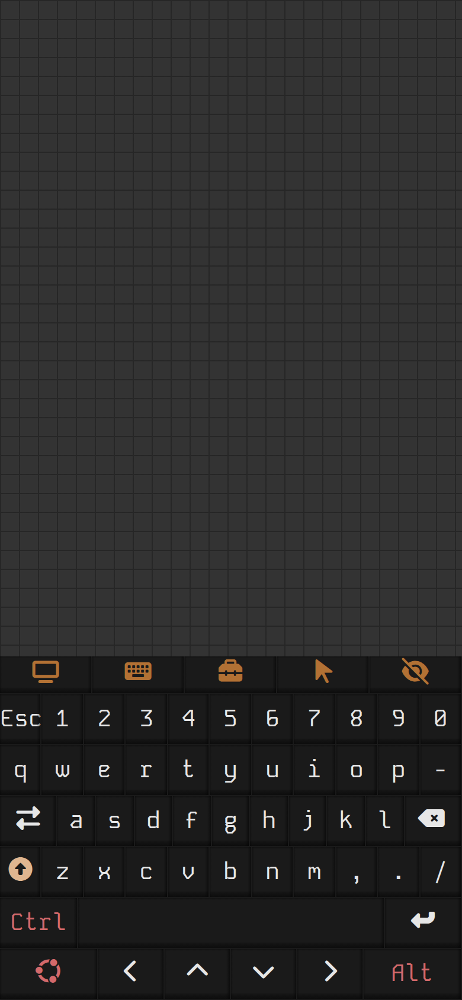
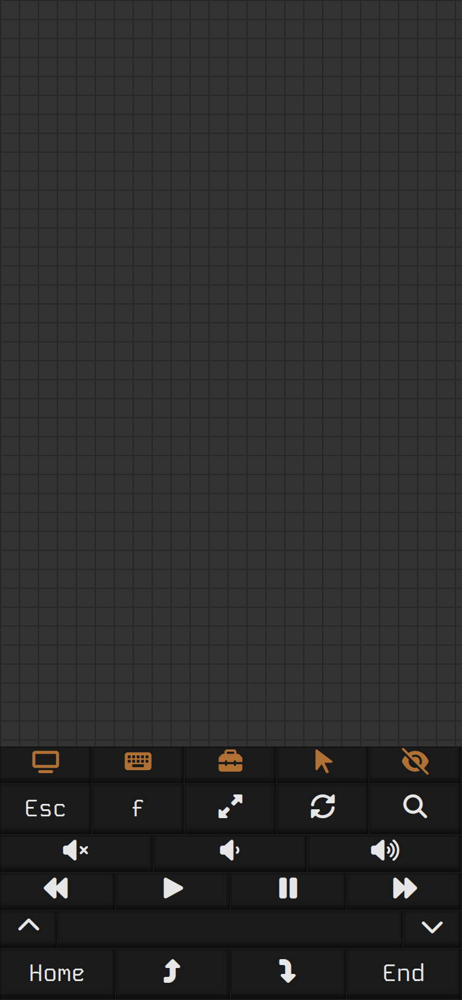
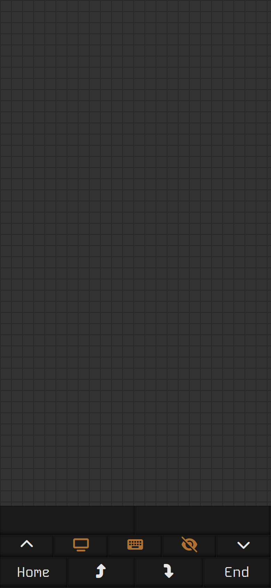

# htpc-remote

> BYOD style control of your Linux/Mac/Windows(untested) based HTPC via a web server.

The interface offers a trackpad and a few keyboard layouts for controlling your HTPC. Open it on a phone; the screen stays awake while it's open.

  

## Setup

Requires [Bun](https://bun.sh/). Mouse and keyboard input goes through [@jitsi/robotjs](https://github.com/jitsi/robotjs).

```sh
bun install
```

`bun install` also sets up the git hooks and builds the client (`vbc-build`, into `client/build`).

## Run

```sh
# Production
bun start

# Development (hot reload)
bun run dev
```

| Flag         | Alias | Default | Description                                                  |
| ------------ | ----- | ------- | ------------------------------------------------------------ |
| `--port`     | `-p`  | `8793`  | Server port                                                  |
| `--simulate` | `-s`  |         | Log each mouse and keyboard command instead of performing it |

The page answers only when reached by an IP address, `localhost`, or this machine's own hostname (for a machine named `htpc`: `htpc`, `htpc.local`, `htpc.lan`).

In development the server rebuilds the client when its files change and reloads open pages; type `b` (or `build`) in its terminal to rebuild by hand, or `stop` to end it.

## Run as a service

`bun run service:enable` installs htpc-remote as a background service on port 8793 (a systemd user unit on Linux, a launchd agent on macOS), through the component library's `vbc-service`. `bun run deploy` rebuilds the client and restarts it; `service:disable` removes it.
